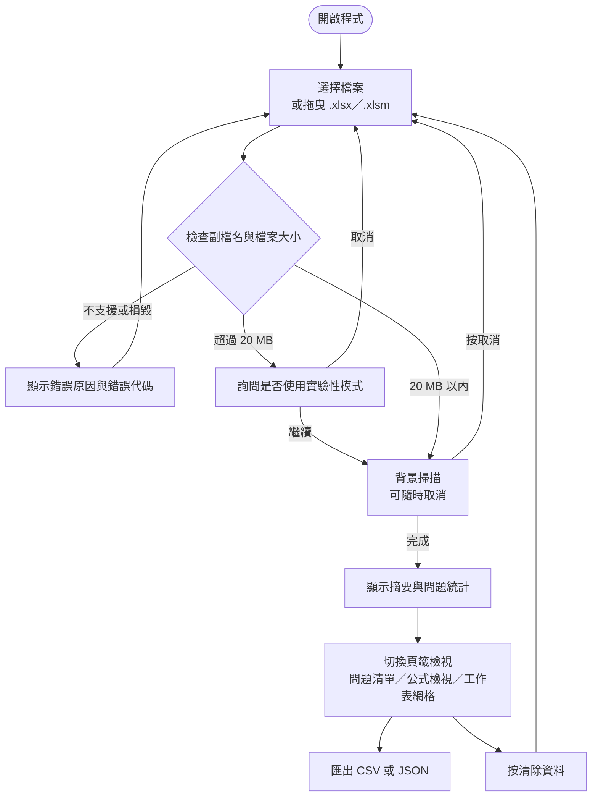

# Excel Formula Inspector 使用手冊

> 版本 1.0.0 · Windows 10（1809 以上）／Windows 11（x64）

Excel Formula Inspector 是 Windows 上的**離線** Excel 公式檢查工具。匯入 `.xlsx` 或 `.xlsm` 工作簿後，
它會列出所有公式、標出錯誤值與可疑的公式模式，並讓你匯出 CSV／JSON 作為稽核紀錄。

它只做靜態檢查：**不重新計算公式、不執行巨集、不讀取外部連結、不發出任何網路連線，也不會修改你的原檔。**

---

## 目錄

- [快速開始](#快速開始)
- [整體使用流程](#整體使用流程)
- [操作介面](#操作介面)
  - [標題列](#標題列)
  - [匯入畫面](#匯入畫面)
  - [摘要](#摘要)
  - [問題清單](#問題清單)
  - [公式檢視](#公式檢視)
  - [工作表網格](#工作表網格)
- [檢查規則與判讀方式](#檢查規則與判讀方式)
- [輸出結果與檔案格式](#輸出結果與檔案格式)
- [設定與記憶](#設定與記憶)
- [隱私與資料安全](#隱私與資料安全)
- [常見問題與排錯](#常見問題與排錯)
- [已知限制](#已知限制)
- [從原始碼建置](#從原始碼建置)
- [授權與第三方元件](#授權與第三方元件)

---

## 快速開始

1. 執行安裝檔 `Excel Formula Inspector_1.0.0_x64-setup.exe`（或直接執行 `excel-formula-inspector.exe`）。
2. 開啟程式，畫面會停在「匯入 Excel 工作簿」。
3. 按「**選擇檔案**」，或把 `.xlsx` / `.xlsm` 直接拖曳到視窗裡。
4. 如果檔案超過 20 MB，會先跳出「檔案較大」的確認視窗；要繼續就按「**以實驗性模式繼續**」。
5. 等待掃描完成。掃描期間隨時可以按「**取消**」，取消後回到可重新匯入的狀態。
6. 完成後在四個頁籤之間切換查看結果：[摘要](#摘要)、[問題清單](#問題清單)、[公式檢視](#公式檢視)、[工作表網格](#工作表網格)。
7. 需要留紀錄時按「**匯出目前篩選 CSV**」等按鈕；用完按右上角「**清除資料**」清掉記憶體中的內容。

> 安裝檔未做程式碼簽章，首次執行時 Windows 可能顯示「Windows 已保護您的電腦」；選擇「更多資訊」→
> 「仍要執行」即可。安裝程式會在需要時一併安裝 WebView2 Runtime（Windows 10／11 通常已內建）。
> 顯示的「快取值」是檔案中**既有的** Excel 計算結果，不是本工具重算的，久未重算的檔案可能已過期。

---

## 整體使用流程



---

## 操作介面

### 標題列

畫面最上方固定顯示：

| 元件 | 說明 |
|---|---|
| 產品名稱與版本 | `Excel Formula Inspector`／`公式靜態檢查器 v1.0.0` |
| 本機處理標記 | 「在此裝置本機處理：`檔名`（`大小`）」，綠點代表未使用網路 |
| 佈景主題 | 「☀ 淺色」／「☾ 深色」切換，**預設淺色** |
| 清除資料 | 清掉已載入的工作簿與所有檢查結果；尚無資料時為停用狀態 |

掃描進行中時，中間會改成顯示檔名、進度條、「讀取工作表」或「執行規則檢查」階段，以及「取消」按鈕。

### 匯入畫面

- 「**選擇檔案**」開啟 Windows 檔案對話框，只列出 `.xlsx` 與 `.xlsm`；也可以直接把檔案拖進視窗。
- 掃描中顯示「正在解析，請稍候…」與「取消」。
- 檔案超過 20 MB 時顯示「**檔案較大（`大小`）**」，並提供「以實驗性模式繼續」與「取消」。
- 匯入失敗時顯示「**無法完成匯入：`檔名`**」、原因與**錯誤代碼**（代碼對照見[排錯](#常見問題與排錯)）。
- 畫面下方固定列出三點隱私聲明：不連線、不執行巨集、清除資料後即移除記憶體內容。

### 摘要

最上排是 8 個統計數字：**工作表、已掃描儲存格、公式儲存格、常數儲存格、錯誤儲存格、問題總數、掃描耗時、檔案大小**。

下面的區塊都可以**點擊直接跳到問題清單並套用篩選**：

| 區塊 | 內容 |
|---|---|
| 依嚴重度 | 高／中／低／提示 的問題數 |
| 依規則分布 | F001–F006 各規則的問題數與長條圖 |
| 工作表 | 每個工作表的已使用範圍、公式數、常數數、錯誤值數、問題數 |

最後一段「掃描資訊與限制」會提醒工具不重算公式，並列出掃描過程的警告（例如略過非一般工作表、
問題數量超過單次傳輸上限）。

### 問題清單

**篩選列**：嚴重度（高／中／低／提示）、規則（F001–F006）、工作表、關鍵字（搜尋說明、公式、儲存格、
工作表與判斷依據），可任意組合，按「**清除篩選**」還原。

**工具列**：顯示「目前顯示筆數 / 總筆數」，以及四個匯出按鈕（見[輸出結果與檔案格式](#輸出結果與檔案格式)）。

**表格**：欄位為嚴重度、規則、工作表、儲存格、說明、公式或值、信心程度。點欄位標題可切換升冪／降冪排序；
清單以虛擬捲動呈現，數萬筆也不卡。被標記的列左側有色條。

**右側明細**：點選任一筆問題後顯示該儲存格的完整資訊——公式、快取值、直接參照、同欄主流簽章、
所有問題的判斷依據，以及同欄上下 3 列的公式模式比較（標示「相同／不同／無法判讀」）。


### 公式檢視

用來逐格檢視公式本身：

| 控制項 | 說明 |
|---|---|
| 工作表 | 切換要檢視的工作表 |
| 位址跳轉 | 輸入位址（例如 `D12`）後按「跳轉」，直接帶出該儲存格的明細 |
| 公式搜尋 | 以關鍵字比對公式原文（例如 `SUM`、`#REF!`、`Inputs!`） |
| 僅顯示被標記的公式 | 只列出被任一條規則標記的公式 |

表格欄位為儲存格、公式、快取值、型別、標記；每頁 200 筆，用「上一頁／下一頁」換頁，上方顯示目前筆數範圍。
被標記的公式以 ⚑ 標示數量，點一列即可在右側看到明細與相鄰比較。

### 工作表網格

以試算表外觀呈現工作表的**已使用範圍**，適合確認實際位置：

- 上方可切換工作表、看到已使用範圍，並用「前往儲存格」（例如 `D120`）跳到指定位置。
- 網格左側是列號、上方是欄名；`⚑` 代表該儲存格有問題標記，公式儲存格會以 `fx` 標示並用不同顏色顯示。
- 資料是以區塊向後端分批取得的，捲到哪裡載入到哪裡，不會一次把整張表讀進畫面。
- 點任一儲存格，右側顯示明細，並可用「在公式檢視中開啟」跳到公式檢視。

---

## 檢查規則與判讀方式

所有結果都標示**嚴重度**（高／中／低／提示）與**信心程度**（高／中／低），並附上「判斷依據」。
啟發式判斷一律使用「**疑似**」措辭，代表需要你人工確認，不是系統判定有錯。

| 規則 | 名稱 | 檢查什麼 | 預設嚴重度 |
|---|---|---|---|
| F001 | Excel 錯誤值 | 儲存格的快取值是錯誤值（例如 `#DIV/0!`、`#N/A`） | 高 |
| F002 | 無效參照 | 公式中出現 `#REF!`（引號內的文字不算） | 高 |
| F003 | 公式模式不一致 | 同一欄的連續公式中，參照位移與主流不同的那幾筆 | 中 |
| F004 | 疑似硬編碼覆寫 | 公式區塊中間夾了一筆常數，且上下都是同模式公式 | 中 |
| F005 | 疑似公式缺口 | 同一公式序列中被略過的空白儲存格 | 低 |
| F006 | 高風險函數提示 | 公式用了 `INDIRECT`、`OFFSET`、`NOW`、`RAND`、`TODAY`、`HYPERLINK` 等不易稽核的函數 | 提示 |

### F003 的比對方式

- 以「同一工作表、同一欄的連續公式區段」為單位比對，**不足 3 筆公式不報警**。
- 相對參照（`B2`）換算成相對於公式儲存格的位移，所以複製往下的公式會被視為同一種模式。
- 絕對參照（`$B$2`）與混合參照（`B$2`、`$B2`）各自處理。
- 需要 60% 以上、至少 2 筆的「主流簽章」才會判定偏離；平手或沒有明顯主流時**不報警**。
- 公式中的數字常值視為相同（逐列不同的稅率、門檻很常見）；字串常值保留比對（字串通常帶有語意）。
- 無法判讀的語法（結構化參照、外部活頁簿、3D 參照、動態陣列）**排除在比對之外**，不會被當成異常。

### 誤報控制

- F004、F005 只在上下相鄰列存在**同模式公式**時才觸發。
- 不會跨越「完全空白的整列」去推測公式應該存在。
- 落在合併儲存格的結果會另外加註「可能造成誤報」。
- 合法的小計、註解、輸入欄都可能被 F004 標記，因此結果一律搭配信心程度與證據，**不宣稱**已證實人為覆寫。

---

## 輸出結果與檔案格式

在「問題清單」頁籤有四個匯出按鈕，按下去會先開啟儲存對話框讓你選位置與檔名：

| 按鈕 | 預設檔名 | 內容 |
|---|---|---|
| 匯出目前篩選 CSV | `issues.csv` | 只含**目前篩選與排序後**的問題 |
| 匯出目前篩選 JSON | `issues.json` | 同上，JSON 格式 |
| 匯出全部 CSV | `issues-all.csv` | 這次掃描的**完整**問題清單 |
| 匯出全部 JSON | `issues-all.json` | 同上，JSON 格式 |

匯出檔只包含檢查結果，**不含**工作簿原始內容。

### CSV 欄位

CSV 使用 UTF-8 並帶 BOM，用 Excel 直接開啟即可正常顯示中文。欄位固定為 9 欄：

| 欄位 | 內容 | 範例 |
|---|---|---|
| 嚴重度(high/medium/low/info) | 固定英文代碼 | `high` |
| 規則ID | F001–F006 | `F003` |
| 工作表 | 工作表名稱 | `Monthly Report` |
| 儲存格 | A1 位址 | `B7` |
| 信心程度(high/medium/low) | 固定英文代碼 | `medium` |
| 說明 | 問題描述（含「疑似」字樣） | `疑似公式模式不一致` |
| 公式 | 公式原文（帶前導 `=`；沒有公式時空白） | `=A6*2` |
| 快取值 | 檔案中的快取值 | `1200` |
| 判斷依據 | 多條證據以直線符號串接 | `同欄連續區塊 C2:C8 的主流簽章…` |

為避免試算表公式注入，若欄位以 `=`、`+`、`-`、`@`、Tab 或換行開頭，會自動在前面加上 `'`。
這是刻意設計，不是資料錯誤。

### JSON

JSON 是一個問題陣列，欄位名稱採 camelCase（`ruleId`、`sheetName`、`cellAddress`、`confidence`、
`message`、`evidence` 等），沒有 BOM。

### 失敗時會怎樣

匯出失敗（例如目標檔案正被 Excel 開啟而無法寫入）時，畫面會顯示錯誤訊息，程式不會中斷，
也不會覆蓋其他檔案。若在儲存對話框按取消，則不會產生任何檔案。

---

## 設定與記憶

本工具**沒有設定檔、不寫入登錄檔、不保留掃描結果**。每次啟動都是乾淨狀態：

- 佈景主題（淺色／深色）只在本次執行期間有效，關閉程式後恢復預設的**淺色**。
- 掃描結果與工作簿內容只存在執行中的記憶體，程式關閉即消失。
- 要中途清掉，按「**清除資料**」：取消進行中的掃描、清掉 Rust 與畫面上的所有結果、回到初始匯入畫面。


---

## 隱私與資料安全

- **完全不連網**：程式不發出任何對外連線，沒有更新檢查、沒有遙測、沒有錯誤回報。
- **不修改原檔**：來源工作簿以唯讀方式開啟，工具只讀不寫。
- **不執行巨集**：`.xlsm` 只讀取儲存格與公式，VBA 內容不會被執行，也無法檢查 VBA 邏輯。
- **不重新計算**：不會觸發公式重算，顯示的快取值取自檔案。
- **不寫入暫存**：工作簿內容不會被寫到瀏覽器儲存、暫存檔或使用者設定目錄；只有你主動匯出時，
  才會寫出 CSV／JSON 檔到你選擇的路徑。
- **匯出防注入**：CSV 會處理試算表公式注入（見上一節）。


### 自行驗證沒有資料外送

1. 開啟**資源監視器**（在「開始」搜尋 `resmon`）→「網路」分頁。
2. 啟動本工具並匯入任何工作簿，觀察 `excel-formula-inspector.exe` 的 TCP 連線數應維持 **0**。
3. 想更嚴謹可以用 Wireshark 或 `netsh trace start capture=yes` 擷取同樣流程。
4. 檢查 `%LOCALAPPDATA%` 與 `%APPDATA%` 底下沒有本工具寫出的工作簿或結果檔。

---

## 常見問題與排錯

每個症狀都對應畫面上的實際訊息；錯誤代碼顯示在錯誤框內。

### 出現「不支援的副檔名「xls」。MVP 僅支援 .xlsx 與 .xlsm。」（`UNSUPPORTED_FORMAT`）

你選到的是舊版 `.xls`、`.xlsb` 或 OpenDocument 檔案，或檔名被改成 `.xlsx` 但內容其實是舊格式。

請用 Excel 開啟後「另存新檔」成 `.xlsx`（或 `.xlsm`），再匯入新檔案。

### 出現「檔案損毀或格式不正確，無法解析。」（`CORRUPT`）

檔案不是標準的 `.xlsx` / `.xlsm`——常見於下載中斷、被其他工具改寫，或只是改了副檔名的佔位檔。

請用 Excel 開啟該檔並另存新檔後再試；若 Excel 本身也打不開，代表來源檔案已損毀，本工具無法分析它。
這種情況不會造成程式崩潰，你可以直接匯入其他檔案。

### 出現「此檔案受密碼保護或已加密，無法解析。」（`ENCRYPTED`）

檔案有開啟密碼或整份加密。

請先在 Excel 中解除密碼保護並另存新檔，再匯入。

### 出現「找不到檔案，可能已被移動或刪除。」（`FILE_NOT_FOUND`）

選取檔案後，檔案在掃描前被搬移、改名或刪除。

請重新按「選擇檔案」再選一次。

### 出現「已使用的儲存格數量…超過上限 500000，為避免記憶體耗盡已拒絕處理。」（`TOO_MANY_CELLS`）

工作簿的已使用儲存格太多。

請先刪除用不到的工作表或多餘資料，或把要檢查的範圍複製到新工作簿後再匯入。

### 出現「檔案大小…超過硬上限 200 MB，為避免記憶體耗盡已拒絕處理。」（`TOO_LARGE`）

超過工具的硬上限，無法繞過。

請拆分工作簿後分別檢查。

### 出現「檔案較大（xx MB）」的確認視窗，這是錯誤嗎？

不是錯誤，是**保護機制**：超過預設上限 20 MB 時會先問你。

按「以實驗性模式繼續」即可處理（會用較多記憶體、耗時較長，建議先關閉其他大型程式）；按「取消」則回到匯入畫面。

### 掃描看起來很久，可以中止嗎？

可以。標題列與匯入畫面的「取消」都能中止掃描，停止後會回到可重新匯入的狀態，不會留下半殘的結果。

參考效能（22 MB、約 28 萬格的測試檔）掃描約 2–3 秒；一般工作簿都在毫秒級完成。

### 看起來應該有問題，但工具沒報

先確認是否為預期行為：

- 同欄同模式的公式**不會**被標記，只有偏離主流的才會。
- 同一欄不足 3 筆公式時不做模式比對。
- 完全空白的整列不會被當成公式缺口。
- 使用了不支援語法（結構化參照、外部活頁簿、3D 參照、動態陣列）的公式顯示為「無法判讀」，不被視為異常。
- 快取值是檔案中的舊結果；若 Excel 尚未重算，錯誤值可能與現況不同。

### 匯出的 CSV 用記事本打開，開頭有奇怪的字元

那是 UTF-8 BOM，用來讓 Excel 正確辨識中文，屬正常現象。請直接用 Excel 開啟 `.csv`。

### 換成深色後，下次開啟又變回淺色

這是預期行為——主題不寫入任何儲存空間，每次啟動都回到預設的淺色（見[設定與記憶](#設定與記憶)）。

### 明細裡的「無法判讀」是什麼意思

代表該公式用了 MVP 尚未支援的語法（結構化參照 `Table1[欄]`、外部活頁簿參照、`Sheet1:Sheet3!A1`
3D 參照、`#`／`@` 動態陣列運算子）。工具刻意保守處理，不會猜測成錯誤。

### 出現「內部錯誤，請重新嘗試。」（`INTERNAL`）

非預期狀況。請關閉程式後重新開啟，再匯入一次；若持續發生，請記錄操作步驟與錯誤代碼回報。

---

## 已知限制

- 快取值未必與公式目前的真實計算結果一致；工具**不會**重新計算。
- 無法僅憑靜態檢查判定公式的商業邏輯是否正確。
- 被覆寫的常數與刻意設置的輸入值可能無法確實區分。
- 無法讀取列／欄的隱藏狀態，因此 F004／F005 的誤報提示不含「隱藏列」這項。
- 不支援的公式語法一律顯示「無法判讀」。
- 不支援 `.xls`、`.xlsb`、加密檔、共用活頁簿修訂歷程，以及 Power Query／資料模型。
- 問題數超過 20,000 筆時，畫面上的清單只會顯示前 20,000 筆（統計數字與「匯出全部」仍是完整結果）。
- 安裝程式以 bootstrapper 安裝 WebView2 Runtime；若系統無法安裝，安裝程序會中止並提示，不會留下無法啟動的程式。

---

## 從原始碼建置

> 一般使用者不需要這一節，安裝檔即可使用。

技術棧：Rust（核心）＋ Tauri v2（桌面殼）＋ React 19 + TypeScript（WebView2 UI）。

前置需求：Node.js 20 以上、Rust 1.77 以上（含 MSVC C++ build tools 的
「使用 C++ 的桌面開發」工作負載）。第一次建置需要網路（下載 NSIS 打包工具），
之後可離線建置。

### 一鍵建置

```bat
build.bat              :: 檢查環境 → 安裝相依 → 建置 → 列出產物，結束前等待按鍵
build.bat --no-pause   :: 供 CI／自動化使用（不等待按鍵，失敗時回傳 exit code 1）
```


### 手動建置與測試

```powershell
npm install
npm run tauri dev      # 開發模式（Vite + Rust，熱重載）

# 測試
cd src-tauri; cargo test   # Rust：90 項（56 單元 + 34 整合）
npm run test               # 前端：29 項（Vitest + React Testing Library）
npm run build              # 型別檢查（tsc --noEmit）+ vite build

# 打包
npm run tauri build
#   → src-tauri/target/release/excel-formula-inspector.exe
#   → src-tauri/target/release/bundle/nsis/*-setup.exe
```

### 產生測試用工作簿（UAT）

```bat
make-uat-files.bat                 :: 產生 9 個測試工作簿到 uat-fixtures\
make-uat-files.bat D:\UAT\files    :: 或指定輸出資料夾
```

檔案由程式產生，不含任何真實資料，並會印出**由實際解析器與規則引擎算出的預期結果**。
測試檔案說明、預期結果與結果記錄表見 [`docs/UAT-GUIDE.md`](docs/UAT-GUIDE.md)；
其中 `UAT-09-large-workbook-over-20MB.xlsx`（約 22 MB）是有效的測試工作簿，
用來驗證「超過 20 MB → 確認 → 實驗性模式 → 成功掃描」的完整流程。

### 專案結構

```text
excel-formula-inspector/
├── SPEC.md · README.md
├── build.bat                     # 建置執行檔／安裝檔（英文批次檔）
├── make-uat-files.bat            # 產生 UAT 測試工作簿（英文批次檔）
├── scripts/make-icon.mjs         # 產生應用程式圖示來源
├── docs/                         # AC 對照表、UAT 指引、E2E 執行說明
├── src/                          # 前端（React + TypeScript，執行於 WebView2）
│   ├── main.tsx · App.tsx · types.ts · state.ts · ipc.ts
│   ├── ui/  header · upload · dashboard · issues-table · formula-explorer · sheet-grid · cell-context
│   └── styles/app.css
├── src-tauri/                    # Rust 後端
│   ├── tauri.conf.json · capabilities/default.json · icons/
│   ├── src/  lib.rs · model.rs · errors.rs · workbook_reader.rs · formula_parser.rs
│   │         formula_signature.rs · rules.rs · engine.rs · commands.rs · exporter.rs
│   ├── examples/make_uat_fixtures.rs   # UAT 工作簿產生器
│   └── tests/                    # Rust 整合測試與 Fixture 產生器
└── tests/                        # 前端測試（Vitest + Testing Library）
```

### 效能與資料流設計

- 解析與規則掃描在**獨立執行緒**執行，不阻塞畫面；進度以事件回報，取消在安全點中止。
- 只走訪實際存在的儲存格，不遍歷整張 Excel 虛擬網格。
- 工作簿資料只留在 Rust 記憶體；前端只取分頁與可見範圍的網格，不一次搬移整份工作簿。
- 大檔策略：20 MB 以內直接處理；20–200 MB 需確認後進入實驗性模式；200 MB 以上或已使用儲存格超過
  500,000 直接拒絕。

### 前後端介面

| 命令 | 說明 |
|---|---|
| `start_scan(path, allowLarge)` | 立即回傳 `scanId`，於背景執行緒掃描 |
| 事件 `scan://progress` | `{ scanId, phase, done, total, label }` |
| 事件 `scan://done` | 完整結果（摘要、工作表、問題） |
| 事件 `scan://error` | `{ scanId, code, message, extra }` |
| `cancel_scan(scanId)` | 取消進行中的掃描 |
| `get_scan_payload` / `get_issues` | 取回結果 |
| `get_formulas(scanId, query)` | 分頁查詢公式清單（位址前綴、關鍵字、僅標記） |
| `get_sheet_window(scanId, sheet, …)` | 網格區塊（單次上限 200×60） |
| `get_cell_context(scanId, sheet, address, span)` | 儲存格明細、直接參照、同欄主流簽章、鄰近公式 |
| `export_issues` / `export_from_scan` | 匯出目前篩選結果／完整結果 |
| `clear_scan` / `clear_all` | 清除結果（並取消進行中的掃描） |

---

## 授權與第三方元件

- `calamine`（MIT）：讀取 `.xlsx` / `.xlsm`。
- `tauri`、`tauri-plugin-dialog`（Apache-2.0 / MIT）。
- `@tanstack/react-table`、`@tanstack/react-virtual`、`zustand`、`react`（MIT）。
- 測試用 `rust_xlsxwriter`（MIT / Apache-2.0）僅作為 dev-dependency，用於程式化產生 Fixture。
